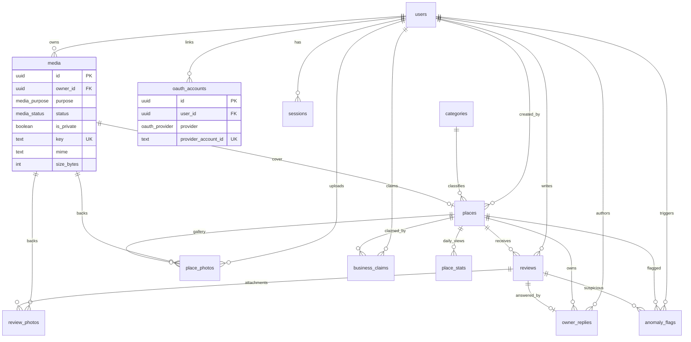

# Darasa API + Database Plan

Base path `/api`. Everything is Elysia + Eden Treaty: each route declares TypeBox
`body`/`query`/`params`/`response`, so the frontend gets types without codegen.

## 1. Conventions

| Topic               | Decision                                                                                                                                                                          |
| ------------------- | --------------------------------------------------------------------------------------------------------------------------------------------------------------------------------- |
| IDs                 | UUIDv4 (`gen_random_uuid()`), opaque to clients                                                                                                                                   |
| Public place lookup | `slug` (`warung-bu-tini`), unique                                                                                                                                                 |
| Dates               | ISO 8601 UTC strings (`2026-11-25T13:00:00.000Z`)                                                                                                                                 |
| Success             | `{ "data": ... }`, lists add `{ "meta": { page, limit, total, totalPages } }`                                                                                                     |
| Error               | `{ "error": { "code", "message", "fields"? } }` + real HTTP status                                                                                                                |
| Pagination          | `page` (1-based, default 1), `limit` (default 20, max 50)                                                                                                                         |
| Auth                | `darasa_session` cookie, HttpOnly, SameSite=Lax, Secure in prod. **Sliding**: 30 days idle, hard cap 180 days                                                                     |
| Session token       | 32 random bytes base64url; only `sha256(token)` stored in `sessions.token_hash`                                                                                                   |
| Roles               | `user`, `owner`, `admin`. `owner` is granted on first approved claim; **per-place authority always comes from an approved `business_claims` row**, never from the role flag alone |
| Money/rating        | rating is `smallint 1..5`; aggregates are `double precision`                                                                                                                      |
| OAuth               | Google via `arctic@3` (`Google` client, PKCE + state). Handshake state is an HttpOnly cookie scoped `Path=/api/auth`, 10-minute TTL, single use                                   |
| Object storage      | RustFS (S3 API) via `Bun.S3Client` — native, zero dependencies, path-style                                                                                                        |

Error codes: `VALIDATION_ERROR` (422, with `fields`), `UNAUTHENTICATED` (401),
`FORBIDDEN` (403), `NOT_FOUND` (404), `CONFLICT` (409), `RATE_LIMITED` (429),
`PAYLOAD_TOO_LARGE` (413), `UNSUPPORTED_MEDIA_TYPE` (415), `INTERNAL_ERROR` (500).

## 2. ERD



Notes that matter:

- `places` has no `owner_id`. Ownership is derived from `business_claims`
  (`status = 'approved'`), so a place can exist with zero owners (PRD 6.2.1).
- `places.rating_avg / review_count / last_review_at / explore_score /
  hidden_gem_score` are a **denormalized ranking cache**, recomputed inside the
  same transaction whenever a published review is created, edited, deleted, or a
  verification flag changes. No cron, no stale window.
- `business_claims` has a partial unique index on `place_id` where
  `status in ('pending','approved')` — one live claim per place, rejected claims
  free the slot.
- `reviews` has `unique (place_id, user_id)` — one review per user per place;
  editing is `PATCH`. (PRD open question 5, resolved as edit-in-place.)
- `owner_replies` has `unique (review_id)` — one owner reply, editable.
- `anomaly_flags` is a review queue, never a verdict (FR-036).
- `media` is the single source of truth for every object in RustFS. Photo and
  cover columns hold `media_id`, never a URL: the public URL is built from
  `MEDIA_PUBLIC_BASE_URL` at serialization, so moving to a CDN or a new bucket
  needs no data migration.
- `users.password_hash` is **nullable** — a Google-only account has no password.
  `oauth_accounts` is separate from `users` so one account can hold both a
  password and one or more linked providers, and identity is keyed on Google's
  `sub`, not email (emails can change).
- The OAuth handshake keeps `state` + `code_verifier` + `redirectTo` in one
  HttpOnly cookie scoped `Path=/api/auth`, `Max-Age=600`, `SameSite=Lax`. The
  callback compares the query `state` to the cookie and deletes the cookie. No
  table, no cleanup job; a stale cookie simply expires.

## 3. Drizzle schema files

```
apps/api/src/database/
  index.ts            # drizzle({ connection: DATABASE_URL, relations })
  relations.ts        # defineRelations(schema, ...) — all r.one / r.many
  schema.ts           # plain table map (no enums/constants, no barrel recursion)
  schema/
    _shared.ts        # timestamps() column factory
    enums.ts          # user_role, place_status, review_status, claim_status, anomaly_*, oauth_provider, media_*
    auth.ts           # users, oauth_accounts, sessions
    media.ts          # media
    places.ts         # categories, places, place_photos
    reviews.ts        # reviews, review_photos, owner_replies, review_rate_limits, place_stats
    claims.ts         # business_claims (+ ClaimEvidence JSON type)
    moderation.ts     # anomaly_flags (+ z threshold constants)
```

`drizzle.config.ts` points at `./src/database/schema/` and emits to `.drizzle/`.

### Ranking (documented, tunable in one file)

All components normalized to `0..1`:

```
ratingPart  = ratingAvg / 5
volumePart  = min(ln(1 + reviewCount) / ln(1 + 50), 1)
recencyPart = lastReviewAt ? exp(-ageDays / 30) : 0
verifyPart  = ownerVerified ? 1 : communityVerified ? 0.5 : 0

exploreScore = 0.5*ratingPart + 0.2*volumePart + 0.2*recencyPart + 0.1*verifyPart
```

```
hiddenGemScore = reviewCount > 0 && ratingAvg >= 4.0
  ? ratingAvg * (1 / (1 + reviewCount))
  : 0
```

Tie-break: `explore_score DESC, review_count DESC, places.id ASC`.
Places with no reviews: score is volume/recency/verify only — they are not
excluded from Explore, but can never enter Hidden Gem (needs `ratingAvg >= 4`).

### Z-score flags

Computed on review create (and by an admin-triggered recompute endpoint is
**not** needed — YAGNI):

- `rating_outlier`: place has ≥ 10 published reviews; new rating's
  `|z| = |x - mean| / stddev` > `ANOMALY_Z_THRESHOLD` (2.5).
- `review_burst`: ≥ 5 reviews on one place within 24 h from distinct users.

Both write `anomaly_flags` with `metrics = { zScore, mean, stdDev, windowDays, sampleSize }`.
A flag never hides or deletes a review; only `PATCH /admin/reviews/:id` can.

## 4. Endpoints

### Auth

Two ways in, one session model. Password and Google both end at the same
`sessions` row + `darasa_session` cookie, so every downstream guard is identical.

| Method | Path                     | Auth                                     |
| ------ | ------------------------ | ---------------------------------------- |
| POST   | `/auth/register`         | public                                   |
| POST   | `/auth/login`            | public                                   |
| GET    | `/auth/google`           | public                                   |
| GET    | `/auth/google/callback`  | public                                   |
| POST   | `/auth/logout`           | session                                  |
| GET    | `/auth/me`               | session                                  |
| DELETE | `/auth/sessions`         | session (planned, not in this milestone) |
| DELETE | `/auth/providers/google` | session (planned, not in this milestone) |

**POST /auth/register**

```jsonc
// body
{ "name": "Arya", "email": "arya@example.com", "password": "min8chars" }
// 201
{ "data": { "id": "uuid", "name": "Arya", "email": "arya@example.com",
            "role": "user", "avatarUrl": null,
            "hasPassword": true, "linkedProviders": [],
            "createdAt": "..." } }
```

`409 CONFLICT` if email exists. Sets session cookie on success.
`password` 8–72 chars, `name` 2–80, email lowercased. Hashing is
`Bun.password.hash` (argon2id) — built in, no dependency.

**POST /auth/login** — `{ email, password }` → same user object + cookie.
`401` for wrong credentials, same message for unknown email (no enumeration).
`401` with `code: "OAUTH_ONLY_ACCOUNT"` when the account has
`password_hash IS NULL` — the frontend then shows "continue with Google".

**GET /auth/google** — query `redirectTo` (optional, relative path, default `/`).
Server: `generateState()` + `generateCodeVerifier()`, then `307` to
`google.createAuthorizationURL(state, verifier, ["openid","email","profile"])`
with the handshake stored in a cookie:

```
Set-Cookie: darasa_oauth={"state":"...","verifier":"...","redirectTo":"/..."};
            Path=/api/auth; HttpOnly; SameSite=Lax; Secure (prod); Max-Age=600
```

`redirectTo` is sanitized to a relative path (must start with `/`, not `//`) to
prevent an open redirect. Elysia serializes/parses the object cookie for you
(`cookie.darasaOauth.value` is the parsed object, verified).

**GET /auth/google/callback** — query `code`, `state`, optional `error`.

```
1. error param present                  -> 302 {WEB}/login?error=oauth_denied
2. no cookie, or query state != cookie.state -> 302 {WEB}/login?error=oauth_state
3. clear the handshake cookie immediately (before the exchange)
4. google.validateAuthorizationCode(code, cookie.verifier)
5. claims = decodeIdToken(tokens.idToken())   // unverified decode is fine:
   // the token came straight from Google's token endpoint over TLS, not from
   // the browser. No signature check needed, no JWKS fetch.
6. identity = { sub: claims.sub, email: claims.email, name: claims.name,
                picture: claims.picture }
7. upsert:  oauth_accounts (provider='google', provider_account_id=sub)
            -> existing  => load that user
            -> missing   => users by lowercased email
                            -> found: link oauth_accounts row to it
                            -> none : create user (password_hash NULL,
                                      avatar_url = picture, name from claims)
8. create session, set cookie
9. 302 to {WEB}{cookie.redirectTo}
```

Provider failures never render an error page from the API: always a `302` back
to the web app with `?error=oauth_denied|oauth_state|oauth_exchange`.

**POST /auth/logout** — deletes the session row, clears cookie → `204`.

**DELETE /auth/sessions** — planned, not in this milestone. "Sign out
everywhere": deletes all sessions for the user except the current one →
`{ "data": { "revoked": 3 } }`.

**GET /auth/me** — session user, plus `hasPassword`, `linkedProviders`
(`["google"]`), and `session: { expiresAt }`, so the UI can warn before an idle
timeout and knows whether to offer "set a password" / "disconnect Google".

```jsonc
{
	"data": {
		"id": "uuid",
		"name": "Arya",
		"email": "arya@example.com",
		"role": "user",
		"avatarUrl": null,
		"hasPassword": false,
		"linkedProviders": ["google"],
		"session": { "expiresAt": "2026-12-25T13:00:00.000Z" },
		"createdAt": "..."
	}
}
```

`401` when unauthenticated.

### Session lifetime

The cookie is not a fixed 30-day timer. It is a **sliding idle window with an
absolute cap**:

| Rule             | Value                                                  |
| ---------------- | ------------------------------------------------------ |
| Idle expiry      | `now + 30 days`, refreshed on use                      |
| Absolute cap     | `createdAt + 180 days`                                 |
| Effective expiry | `min(now + 30d, createdAt + 180d)`                     |
| Cookie `Max-Age` | 30 days, re-issued when the server extends the session |

No `last_seen_at` column: the existing `expires_at` is the idle deadline, so one
`UPDATE` both slides and records activity.

Every authenticated request runs the same guard:

```
1. hash the cookie token, SELECT the session row
2. expiresAt <= now                 -> delete row, 401 (or redirect to /login)
3. expiresAt - now <= 29 days       -> expiresAt = min(now + 30d, createdAt + 180d),
                                       and re-issue the cookie in the same
                                       response with Max-Age=30d
4. otherwise                        -> no write, no cookie churn
```

Consequences:

- An active user is **never** logged out mid-session; each day of use pushes the
  expiry forward.
- A dormant user is logged out after 30 idle days — that is the intent.
- After 180 days from first sign-in the session dies regardless of activity, so
  a leaked token has a bounded lifetime. The user signs in again (Google is one
  click).
- The `<= 29 days remaining` threshold keeps the hot path read-only: at most one
  `UPDATE sessions` per user per day, not per request. Verified the boundary:
  fresh session = 30 days left (no write), 1 day later = 29 days (write),
  second request the same day = 29.99 days (no write).

### Why sessions, not `access_token` + `refresh_token`

The Google tokens returned by `validateAuthorizationCode` are **discarded** after
we read `sub`/`email`/`name`/`picture` from the ID token. They are credentials for
Google's APIs, not for ours.

|               | Session row (used)     | access + refresh (not used)                      |
| ------------- | ---------------------- | ------------------------------------------------ |
| Authenticates | our API                | Google's API                                     |
| Server state  | 1 row we own           | refresh token store + rotation + reuse detection |
| Revocation    | `DELETE` row, instant  | valid until `exp`; needs a blocklist (= DB read) |
| Leak impact   | one revocable session  | the user's Google account                        |
| Cost/request  | 0.07 ms indexed lookup | 0 DB, but ~1 h expiry forces constant refresh    |

Measured on this repo (local Postgres, 50k sessions, warm): session lookup +
sha256 = 0.072 ms, JWT verify = 0.018 ms — 55 µs apart, against requests that
already hit the DB for places and reviews.

Revisit only if: a mobile client or cross-origin SPA cannot hold a `SameSite`
cookie, a public third-party API is exposed, or a feature genuinely needs to call
Google on the user's behalf (e.g. importing Google Business Profile photos).
That last case adds a separate `google_credentials` table with an **encrypted**
refresh token, scoped to that feature — it does not replace the session.

Frontend behavior:

- `GET /auth/me` returns `{ expiresAt }` so the UI can show a warning and refresh
  state before an idle timeout.
- A `401` from any endpoint means "session gone" → redirect to `/login?next=...`,
  preserving the page the user was on.

Account-linking rules:

- A Google sign-in whose `sub` is unknown but whose **email matches an existing
  password account** links to that account (Google has verified the email).
- A password account cannot be silently created for an email that already has a
  Google account with a different `sub` — it links by email, one user row.
- Unlinking the last credential (`DELETE /auth/providers/google`) is planned, not
  in this milestone; it will be rejected with `409 LAST_CREDENTIAL` when
  `password_hash IS NULL`.

### Media (RustFS)

Presigned direct-to-RustFS upload. The API never proxies image bytes, so a 5 MB
photo costs no API memory and no request timeout.

Buckets:

| Bucket           | Visibility         | Contents                                       |
| ---------------- | ------------------ | ---------------------------------------------- |
| `darasa-public`  | public-read policy | place photos, review photos, avatars           |
| `darasa-private` | private            | claim evidence (NIB, permits, IDs) — presigned |

Keys are server-chosen, never client-chosen:
`tmp/{userId}/{mediaId}.{ext}` while a photo is pending (public bucket),
`claims/tmp/{userId}/{mediaId}.{ext}` while a claim document is pending (private
bucket from the first byte), → `places/{userId}/{mediaId}.{ext}`,
`reviews/{userId}/{mediaId}.{ext}`, `claims/{userId}/{mediaId}.{ext}` once
committed. The real place/review id is bound at attach time, not in the key.

| Method | Path                | Auth         |
| ------ | ------------------- | ------------ |
| POST   | `/media/uploads`    | session      |
| POST   | `/media/:id/commit` | session      |
| GET    | `/media/:id/url`    | owner, admin |
| DELETE | `/media/:id`        | owner, admin |

**POST /media/uploads**

```jsonc
// body
{ "purpose": "place_photo", "mime": "image/webp", "sizeBytes": 421233 }
// 201
{ "data": {
    "id": "uuid",
    "uploadUrl": "https://rustfs.../darasa-public/tmp/...?X-Amz-...",
    "method": "PUT",
    "headers": { "Content-Type": "image/webp", "Content-Length": "421233" },
    "expiresIn": 600 } }
```

- `purpose` ∈ `place_photo|review_photo|claim_document`; `claim_document` picks
  the private bucket and allows `application/pdf`.
- Allowed: `image/jpeg|png|webp` ≤ 5 MB, `application/pdf` ≤ 10 MB (documents
  only). Anything else → `415`; oversize → `413`.
- The presigned PUT signs **only `host`** — `Bun.S3Client.presign` cannot sign
  `Content-Type`/`Content-Length` (the AWS SDK could). So the URL does **not**
  constrain what the client stores; `commit` enforces it by sniffing magic bytes
  and re-writing the object with a server-chosen type. `sizeBytes` in the request
  is a hint used to pick the bucket/limit, never trusted for validation.
- Inserts `media` with `status='pending'`,
  `key = tmp/{userId}/{id}.{ext}` (`claims/tmp/{userId}/{id}.{ext}` for a
  `claim_document`, so evidence never lands in the public bucket).
- Rate limit: 30 uploads/user/hour — **not yet implemented**; planned with the
  rate-limit work.

**POST /media/:id/commit** — `{ }` (empty body). The browser calls this after
the PUT succeeds.

```
1. media row must belong to caller, status='pending'
2. stat(key)      -> size + stored ContentType (authoritative, not client claims)
3. file(key).slice(0, 12) -> magic bytes
   jpeg FFD8FF | png 89504E47 | webp RIFF....WEBP | pdf %PDF
   mismatch -> delete object, 415
4. size > limit -> delete object, 413
5. re-write the bytes to the final key with the SERVER-chosen Content-Type,
   then delete the tmp key  (see "Why re-write, not copy")
6. update media status='ready', mime, sizeBytes
```

Returns `{ "data": { "id", "url", "mime", "sizeBytes" } }`. `url` is
`{MEDIA_PUBLIC_BASE_URL}/{key}` for ready public media and a 10-minute presigned
GET URL for private media; clients use `GET /media/:id/url` to refresh.

**Why re-write, not copy** — three reasons, all verified on RustFS:

1. `Bun.S3Client` has no `copy`. (`CopyObject` exists in the S3 spec but is not
   exposed.)
2. `presign` signs **only `host`** (`X-Amz-SignedHeaders=host`), so the browser
   can PUT any `Content-Type` it likes. Verified: uploading `text/html` under a
   `.webp` key succeeds and RustFS stores `text/html`. Serving that from the
   public bucket is stored XSS.
3. Re-writing lets the **server** set the content type from the magic bytes it
   just sniffed, which fixes the hole. The commit path currently buffers the
   object, so the re-write costs at most the 5 MB image cap (10 MB for documents)
   of heap per in-flight commit. Streaming (`s3.file(src).stream()` →
   `s3.write(dst, stream)`) is the upgrade path if the cap or concurrency grows.

Cost: one extra round-trip through the API process per upload. At a 5 MB limit
and prototype traffic that is nothing; it also gives a natural place to add
resizing later.

**GET /media/:id/url** — owner or admin only. Returns a 10-minute presigned GET
URL for private media, and for public media only once the row is `ready` (a
pending object has never been sniffed, so it gets a presigned URL too). `404` for
anyone else (no existence leak).

**DELETE /media/:id** — owner or admin. Deletes the object, cascades
`place_photos`/`review_photos` rows, nulls `places.cover_media_id` if it was the
cover. `204`.

Attachment is validated server-side: `POST /places` and `POST /reviews` accept
`photoMediaIds` and reject any id that is not `status='ready'`,
`purpose`-matching, and owned by the caller (`403`).

RustFS operational notes (all verified against a live container, via
`Bun.S3Client`):

- Path-style is the default in `Bun.S3Client`; virtual-host style needs
  `RUSTFS_SERVER_DOMAINS`.
- Buckets are private by default (direct GET → `403`); `darasa-public` needs an
  explicit `s3:GetObject` bucket policy, verified `200` after applying it.
- `RUSTFS_CORS_ALLOWED_ORIGINS` must list the web origin or browser PUTs fail
  preflight. It is unset by default — this is the one config step that silently
  breaks uploads if forgotten.
- Lifecycle rule on `darasa-public` prefix `tmp/` with `Expiration: 1 day`
  reaps abandoned uploads; supported by RustFS. Add the same rule for
  `darasa-private` prefix `claims/tmp/`.
- `Region: "us-east-1"` and any non-empty credentials work; set real
  `RUSTFS_ACCESS_KEY`/`RUSTFS_SECRET_KEY` outside local dev.
- `stat()` on a missing key throws `NoSuchKey`; `exists()` returns `false` —
  use `exists` for checks, `stat` when you need size/type.
- `list({ prefix, startAfter, maxKeys })` paginates with `isTruncated` +
  `continuationToken`; `delete()` takes one key at a time.
- Bucket creation and bucket policy are **not** in `Bun.S3Client` (only object
  ops). Bootstrap them once with `aws` CLI, `mc`, or the RustFS console.

### Discovery (public)

| Method | Path                  | Notes                      |
| ------ | --------------------- | -------------------------- |
| GET    | `/categories`         | full list, `sortOrder` asc |
| GET    | `/places`             | Explore, ranked            |
| GET    | `/places/hidden-gems` | Hidden Gem list            |
| GET    | `/places/:slug`       | detail by slug or uuid     |
| GET    | `/places/:id/reviews` | paged reviews              |
| POST   | `/places/:id/view`    | fire-and-forget stat bump  |

**GET /places** query:

| Param          | Type                              | Default   | Behavior                                                 |
| -------------- | --------------------------------- | --------- | -------------------------------------------------------- |
| `q`            | string 1–80                       | —         | ILIKE on `name` + `description`                          |
| `category`     | slug                              | —         | exact category                                           |
| `sort`         | `explore\|newest\|rating\|nearby` | `explore` | `nearby` requires lat/lng                                |
| `lat`,`lng`    | number                            | —         | WGS84, validated `-90..90` / `-180..180`                 |
| `radiusKm`     | number 1–50                       | 5         | only with lat/lng, bounding-box prefilter then haversine |
| `verified`     | `community\|owner\|any`           | —         | filter on flags                                          |
| `page`,`limit` | int                               | 1, 20     |                                                          |

Response item (list shape — never the full row):

```jsonc
{
	"data": [
		{
			"id": "uuid",
			"slug": "warung-bu-tini",
			"name": "Warung Bu Tini",
			"category": {
				"id": "uuid",
				"name": "Warung",
				"slug": "warung",
				"icon": "utensils"
			},
			"address": "Jl. Raya Batang No. 12",
			"latitude": -6.9123,
			"longitude": 109.7301,
			"coverUrl": "https://media.darasa.id/places/p1/a.webp",
			"ratingAvg": 4.6,
			"reviewCount": 12,
			"communityVerified": true,
			"ownerVerified": false,
			"exploreScore": 0.83,
			"hiddenGemScore": 0.354,
			"lastReviewAt": "..."
		}
	],
	"meta": { "page": 1, "limit": 20, "total": 48, "totalPages": 3 }
}
```

Only `status = 'published'` rows are returned here.

**GET /places/hidden-gems** — same item shape + `hiddenGemScore` sorted desc;
query `category`, `page`, `limit`. Filters `status='published' AND review_count > 0
AND rating_avg >= 4.0`, ordered `hidden_gem_score DESC`.

**GET /places/:slug** — full detail:

```jsonc
{ "data": {
  "id": "uuid", "slug": "...", "name": "...", "description": "...",
  "category": { ... }, "address": "...", "phone": "+62...",
  "latitude": -6.9123, "longitude": 109.7301,
  "openingHours": { "mon": { "open": "08:00", "close": "21:00" }, "sun": null },
  "coverUrl": "https://media.darasa.id/places/p1/a.webp",
  "photos": [ { "id": "uuid", "url": "...", "mediaId": "uuid", "sortOrder": 0 } ],
  "ratingAvg": 4.6, "reviewCount": 12,
  "communityVerified": true, "ownerVerified": false,
  "exploreScore": 0.83, "hiddenGemScore": 0.354,
  "createdAt": "...", "updatedAt": "..."
} }
```

`pending`/`rejected`/`archived` places are `404` for the public unless the
requester is an admin or an approved owner of that place.

**GET /places/:id/reviews** query: `page`, `limit`, `sort=recent|highest|lowest`,
`withPhotos=true`. Response:

```jsonc
{ "data": [ {
  "id": "uuid", "rating": 5, "body": "Sambalnya juara.",
  "user": { "id": "uuid", "name": "Arya", "avatarUrl": null },
  "photos": [ { "id": "uuid", "url": "..." } ],
  "ownerReply": { "id": "uuid", "body": "Terima kasih!", "authorName": "Bu Tini",
                  "createdAt": "...", "updatedAt": "..." },
  "createdAt": "...", "updatedAt": "...", "mine": false
} ], "meta": { ... } }
```

Only `status='published'` reviews. `mine` is true when the session user wrote it.

**POST /places/:id/view** — `204`. Upserts `place_stats (place_id, day=today)`:
`views = views + 1`. `day` is `YYYYMMDD` integer (timezone Asia/Jakarta).

### Contributions (session required)

| Method | Path                          | Auth                   |
| ------ | ----------------------------- | ---------------------- |
| POST   | `/places`                     | session                |
| PATCH  | `/places/:id`                 | admin                  |
| DELETE | `/places/:id`                 | admin                  |
| POST   | `/places/:id/photos`          | session                |
| DELETE | `/places/:id/photos/:photoId` | uploader, owner, admin |
| POST   | `/places/:id/reviews`         | session                |
| PATCH  | `/reviews/:id`                | author                 |
| DELETE | `/reviews/:id`                | author, admin          |

**POST /places** — JSON. Uploads go through `POST /media/uploads` +
`POST /media/:id/commit` first; the place references committed media ids:

```jsonc
{
	"name": "Warung Bu Tini",
	"categoryId": "uuid",
	"latitude": -6.9123,
	"longitude": 109.7301,
	"address": "Jl. Raya Batang No. 12",
	"description": "optional",
	"phone": "optional",
	"openingHours": { "mon": { "open": "08:00", "close": "21:00" } },
	"photoMediaIds": ["uuid"]
}
```

- slug is derived from `name` + short id suffix, unique.
- created with `status = 'pending'`, `createdById = session user`.
- `photoMediaIds` (max 5) must be `status='ready'`, `purpose='place_photo'`,
  owned by the caller — else `403`. `place_photos` rows are created with
  `sortOrder` = array index, `photoMediaIds[0]` becomes `coverMediaId`, and each
  object is moved `tmp/...` → `places/{userId}/{mediaId}.{ext}`. (The real
  `placeId` is not known until the place exists, so the owner id scopes the key;
  keys are opaque, and the media row is what binds an object to a place.)
- `201` returns the detail shape.
- Rate limit: 3 submissions/user/day (`429 RATE_LIMITED`).

**PATCH /places/:id** (admin) — any of `name, categoryId, latitude, longitude,
address, description, phone, openingHours, coverMediaId, status`.
`status` transitions: `pending → published|rejected`, `published → archived`,
`archived → published`. Invalid transition → `409`.

**DELETE /places/:id** (admin) — soft delete: `status = 'archived'` → `204`.

**POST /places/:id/photos** — `{ "photoMediaIds": ["uuid"] }`, max 5, appended
after the current max `sortOrder`, objects moved out of `tmp/`. `201` returns
photo rows with `url` + `mediaId`.

**DELETE /places/:id/photos/:photoId** — allowed for uploader, approved owner,
admin. If the removed photo was the cover, cover becomes the next photo or null.

**POST /places/:id/reviews** — one per user per place:

```jsonc
{
	"rating": 5,
	"body": "Sambalnya juara, porsinya pas.",
	"photoMediaIds": ["uuid"]
}
```

- `rating` 1–5 required, `body` optional 10–2000 chars (DB CHECK enforces both).
- `409 CONFLICT` if the user already reviewed this place → use `PATCH`.
- Rate limit: 5 reviews/user/day via `review_rate_limits` (`429`).
- In one transaction: insert review + photos, recompute place aggregates and
  scores, run z-score check, maybe insert `anomaly_flags`.
- `201` returns the review object.

**PATCH /reviews/:id** (author) — `{ rating?, body?, photoMediaIds? }`. Replaces
photos when `photoMediaIds` present. Recomputes aggregates. `403` if not author,
`409` if review is `removed`.

**DELETE /reviews/:id** (author or admin) — sets `status='removed'` (keeps the
row for audit and anomaly history), recomputes aggregates → `204`.

### Claims

| Method | Path                        | Auth    |
| ------ | --------------------------- | ------- |
| POST   | `/places/:id/claims`        | session |
| GET    | `/claims/mine`              | session |
| GET    | `/admin/claims`             | admin   |
| POST   | `/admin/claims/:id/approve` | admin   |
| POST   | `/admin/claims/:id/reject`  | admin   |

**POST /places/:id/claims**

```jsonc
{
	"evidence": {
		"note": "Pemilik warung, NIB 1234567890123",
		"documentMediaIds": ["uuid"],
		"contactPhone": "+628123456789"
	}
}
```

`201` returns the claim with `status: "pending"`. `409` if a live claim already
exists for that place (partial unique index) or the claimant already has an
approved claim for it. `404` if place is not published.

`documentMediaIds` (max 5) must be `purpose='claim_document'`, `status='ready'`,
owned by the caller. Evidence never touches the public bucket: the presigned PUT
targets `claims/tmp/{userId}/{mediaId}.{ext}` in the **private** bucket from the
first byte, and commit keeps it under `claims/{userId}/{mediaId}.{ext}`. The
response returns no URLs, only ids. Admin reads them via `GET /media/:id/url`
(10-minute presigned GET), which keeps evidence out of any public URL and out of
browser history/CDN logs. Apply a 1-day lifecycle rule to `claims/tmp/` on the
private bucket to reap abandoned uploads.

**GET /claims/mine** — all claims by the session user, newest first, with
`place: { id, slug, name, coverUrl }`.

**GET /admin/claims** query: `status=pending|approved|rejected` (default
`pending`), `page`, `limit`. Items include claimant `{ id, name, email }`,
place `{ id, slug, name }`, evidence, timestamps.

**POST /admin/claims/:id/approve** — body `{ "note": "optional" }`. Transaction:
claim `approved` + `reviewedById/reviewedAt`; `places.ownerVerified = true`;
claimant `role` promoted `user → owner` (admin stays admin). `409` if not pending.

**POST /admin/claims/:id/reject** — body `{ "note": "required, 5..500" }`.
Sets claim `rejected`; place and role untouched. `409` if not pending.

### Owner dashboard

All routes require an **approved** claim on the target place (or admin).

| Method | Path                        |
| ------ | --------------------------- |
| GET    | `/owner/places`             |
| GET    | `/owner/places/:id`         |
| PATCH  | `/owner/places/:id`         |
| GET    | `/owner/places/:id/reviews` |
| PUT    | `/owner/reviews/:id/reply`  |
| DELETE | `/owner/reviews/:id/reply`  |
| GET    | `/owner/places/:id/stats`   |

**GET /owner/places** — places the session user has an approved claim on:
`[{ id, slug, name, coverUrl, status, ratingAvg, reviewCount,
    ownerVerified, pendingClaims }]`.

**PATCH /owner/places/:id** — editable: `address, description, phone,
openingHours, coverMediaId` (must be a committed `place_photo` of this place).
Name, category, coordinates and status are
**not** owner-editable (identity fields → admin). Attempting them → `403`
with `fields`. Response: updated detail.

**GET /owner/places/:id/reviews** query: `page`, `limit`, `unanswered=true`.
Same review shape + `ownerReply`.

**PUT /owner/reviews/:id/reply** — `{ "body": "Terima kasih atas kunjungannya." }`
(1–1000). Upserts on the unique `review_id`; author is the session user,
`placeId` taken from the review. `201` on create, `200` on edit.

**DELETE /owner/reviews/:id/reply** → `204`.

**GET /owner/places/:id/stats** query `days=7|30|90` (default 30):

```jsonc
{
	"data": {
		"days": 30,
		"totalViews": 812,
		"daily": [{ "day": 20261101, "views": 24 }],
		"ratingAvg": 4.6,
		"reviewCount": 12,
		"unansweredReviews": 3,
		"lastReviewAt": "..."
	}
}
```

Views come from `POST /places/:id/view`; that is the only "visit" definition
(PRD open question 9).

### Admin

| Method | Path                             |
| ------ | -------------------------------- |
| GET    | `/admin/places`                  |
| PATCH  | `/admin/places/:id/verification` |
| PATCH  | `/admin/reviews/:id`             |
| GET    | `/admin/anomalies`               |
| POST   | `/admin/anomalies/:id/resolve`   |

**GET /admin/places** query: `status` (default `pending`), `q`, `page`, `limit`.
Full row + category + creator `{ id, name, email }`.

**PATCH /admin/places/:id/verification** — `{ "communityVerified": true }` or
`{ "ownerVerified": false }`. Recomputes scores. `409` if clearing
`ownerVerified` while an approved claim exists (reject/close the claim first).

**PATCH /admin/reviews/:id** — `{ "status": "published|hidden|removed" }`.
Recomputes the place aggregates (hidden/removed reviews are excluded).

**GET /admin/anomalies** query: `status=open|dismissed|confirmed` (default
`open`), `kind`, `placeId`, `page`, `limit`. Items include place, review
(if any), user, metrics, reason.

**POST /admin/anomalies/:id/resolve** — `{ "status": "dismissed|confirmed",
"note": "required 5..500" }`. `409` if already resolved. Never touches the
review or the score by itself.

## 5. Authorization matrix

| Action                        | visitor | user | approved owner  | admin |
| ----------------------------- | ------- | ---- | --------------- | ----- |
| Read published places/reviews | yes     | yes  | yes             | yes   |
| Sign in with Google           | yes     | yes  | yes             | yes   |
| Presign own upload            | no      | yes  | yes             | yes   |
| Read own private media        | no      | yes  | yes             | yes   |
| Read others' private media    | no      | no   | no              | yes   |
| Read pending place            | no      | no   | yes (own)       | yes   |
| Create place / review / claim | no      | yes  | yes             | yes   |
| Edit own review               | no      | yes  | yes             | yes   |
| Edit place business info      | no      | no   | yes (own)       | yes   |
| Edit place identity/status    | no      | no   | no              | yes   |
| Reply to review               | no      | no   | yes (own place) | yes   |
| Approve claim / verification  | no      | no   | no              | yes   |

## 6. Configuration

```bash
# api
DATABASE_URL=postgres://...
WEB_APP_URL=http://localhost:5173
SESSION_COOKIE_SECURE=false            # true in prod

GOOGLE_CLIENT_ID=...apps.googleusercontent.com
GOOGLE_CLIENT_SECRET=...
GOOGLE_REDIRECT_URI=http://localhost:3000/api/auth/google/callback

S3_ENDPOINT=http://localhost:9000      # RustFS S3 API (console is 9001)
S3_REGION=us-east-1
S3_ACCESS_KEY=rustfsadmin
S3_SECRET_KEY=rustfsadmin
S3_BUCKET_PUBLIC=darasa-public
S3_BUCKET_PRIVATE=darasa-private
MEDIA_PUBLIC_BASE_URL=http://localhost:9000/darasa-public
```

Google Cloud Console: authorized redirect URI must exactly match
`GOOGLE_REDIRECT_URI`. Local dev over plain HTTP works on `localhost`; any other
host needs HTTPS.

RustFS bootstrap (once, per environment):

```bash
# 1. buckets (Bun.S3Client cannot create buckets)
aws --endpoint-url $S3_ENDPOINT s3 mb s3://darasa-public
aws --endpoint-url $S3_ENDPOINT s3 mb s3://darasa-private

# 2. public-read on the public bucket, scoped to places/* and reviews/*
#    (`claims/*` never lives there; the tmp prefix is transient and unserved)
#    direct GET is 403 until this policy exists — verified
# 3. RUSTFS_CORS_ALLOWED_ORIGINS=$WEB_APP_URL on the RustFS process
# 4. lifecycle: expire darasa-public prefix tmp/ and darasa-private prefix
#    claims/tmp/ after 1 day
```

The API itself needs **no S3 dependency**: `Bun.S3Client` covers `write`,
`file().slice()` (magic-byte sniff), `stat`, `exists`, `size`, `list`,
`delete`, and `presign` (GET + PUT).

## 7. Build order

1. `auth`: password register/login/logout/me + cookie guard macro.
2. `auth/google` + `/auth/google/callback` (arctic `Google`, cookie-backed state).
3. `media`: presign → commit (HEAD + magic-byte sniff + copy) → delete.
4. `categories` + `places` read endpoints (Explore, Hidden Gem, detail).
5. `reviews` write path + aggregate/score recompute (single service function).
6. `claims` + admin approve/reject (private evidence via presigned GET).
7. `owner` dashboard + replies + stats.
8. `admin` moderation + anomaly queue.

Skipped on purpose: email verification, password reset, refresh tokens, SSE,
promoted listings, WhatsApp API, server-side image resizing (RustFS stores the
original; add a resize step in `commit` when bandwidth or LCP demands it). Add
when the prototype has real users and a mail provider; none of them unblock the
acceptance criteria.
